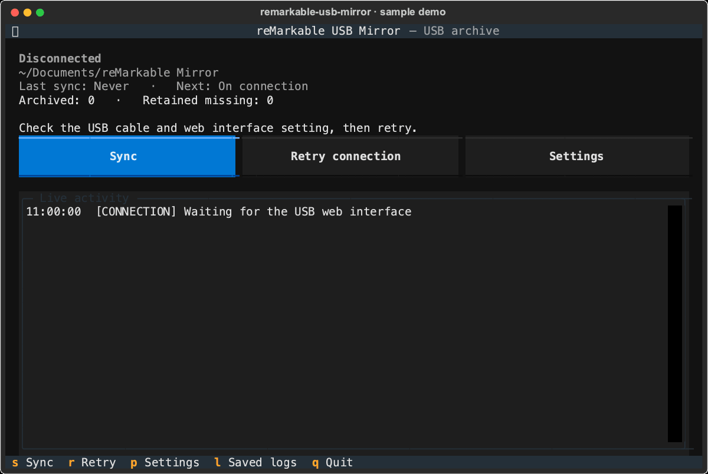

# reMarkable USB Mirror

**Your reMarkable notebooks, archived over USB.**

Keep local PDF and RMDOC copies with a keyboard-driven terminal app. Sync automatically when your tablet connects, follow live progress, and preserve previous revisions and detected local edits. The app only reads from the tablet and retains local copies when documents disappear from the device.



*Actual app interface with simulated sample activity; no tablet or personal documents used.*

- **USB workflow:** connect your tablet and enable its USB web interface.
- **Automatic archiving:** sync on connection and every 15 minutes by default.
- **PDF + RMDOC:** keep readable exports alongside native document archives.
- **Visible progress:** watch transfers, inspect saved logs, and adjust settings from the terminal.

## Supported operating systems

| OS | Support |
| --- | --- |
| macOS | Primary platform; includes launch at login. |
| Linux | Expected to support core syncing, but not yet tested. Launch at login is unavailable. |
| Windows (native) | Not currently supported; the app requires Unix-specific file locking and filesystem operations. |

On Linux, the tablet's USB web interface must be reachable. Settings and state default to a macOS-style path on all platforms; use `--data-dir` to choose a Linux location:

```sh
uv run remarkable-usb-mirror.py --data-dir ~/.local/share/remarkable-usb-mirror
```

## Setup

With [uv](https://docs.astral.sh/uv/) installed:

```sh
git clone https://github.com/Adrivero/remarkable-usb-mirror.git
cd remarkable-usb-mirror
uv run remarkable-usb-mirror.py
```

uv handles Python 3.12 or later and installs the dependencies declared inside the script automatically.

Connect the tablet with a USB data cable and enable its USB web interface. The default address is `10.11.99.1`. Press `p` to change settings.

Keep the terminal open for automatic syncing. The app syncs when the tablet connects, then every 15 minutes by default. It refreshes exports after seven days even if their metadata has not changed.

## Controls

| Key | Action |
| --- | --- |
| `s` | Sync now |
| `r` | Retry connection |
| `f` | Force full refresh |
| `p` | Settings |
| `l` | Saved logs |
| `o` | Open archive folder |
| `q` / `Ctrl+C` | Quit safely |

Settings include the archive folder, device address, intervals, export formats, and revision history. On macOS, launch at login opens a Terminal session. If you move this project, toggle that setting off and on to update the script path.

## Commands

```sh
uv run remarkable-usb-mirror.py status                 # Connectivity and archive statistics
uv run remarkable-usb-mirror.py scan                   # List tablet documents
uv run remarkable-usb-mirror.py sync --dry-run         # Preview downloads
uv run remarkable-usb-mirror.py sync                   # Sync once and exit
uv run remarkable-usb-mirror.py sync --force-refresh   # Download all selected formats again
uv run remarkable-usb-mirror.py verify                 # Check hashes and preserve local edits
uv run remarkable-usb-mirror.py --help
```

Commands print JSON results. `status` exits nonzero if disconnected, `sync` if incomplete, and `verify` if files are missing or changed. Verification can save copies of edited files.

## Files and settings

- **Documents:** `~/Documents/reMarkable Mirror/`
- **Settings and state:** `~/Library/Application Support/reMarkable USB Mirror/`
- **Inside the state folder:** `config.json`, `state.sqlite3`, `history/`, `conflicts/`, and `logs/` as needed.


To use a separate state folder, put `--data-dir` before the command:

```sh
uv run remarkable-usb-mirror.py --data-dir ./local-state status
```

This changes the settings and state location, not the document archive location.

## Troubleshooting

If the USB is connected and the app does not recongize the tablet, check that the device is reachable at `10.11.99.1` and in the tablet under `Settings > Storage` that the web interface is enabled


## Project structure

```text
remarkable-usb-mirror.py  Entry point and inline dependencies for uv
src/                     Application code
├── main.py       `      Command parsing and command execution
├── config.py            Defaults, settings validation, and config.json
├── usb_client.py        USB HTTP requests and document downloads
├── scanner.py           Walks the tablet's document hierarchy
├── change_detector.py   Decides which documents need downloading
├── downloader.py        Validates downloaded PDF and RMDOC files
├── sync_engine.py       Coordinates archiving, verification, and recovery
├── filesystem.py        Safe paths, file writes, locks, and preserved copies
├── database.py          SQLite tracking of documents and archive state
├── models.py            Shared document models, results, and errors
├── events.py            Progress events and persistent logs
├── scheduler.py         Connection polling and automatic sync timing
├── service.py           Connects background syncing with settings changes
├── login.py             macOS launch-at-login setup
└── tui/
    ├── app.py           Main terminal interface and keyboard actions
    └── screens.py       Settings, confirmation, and log screens
tests/                   Tests for syncing, USB requests, files, CLI, and UI
pytest.ini               Test configuration
README.md                Setup and usage instructions
```


## Tests

Only needed when developing or contributing. Run all tests with:

```sh
uv run --with pytest --with pytest-asyncio --with "httpx>=0.28,<1" --with "textual>=8.2,<9" --with "pypdf>=5,<7" python -m pytest
```

